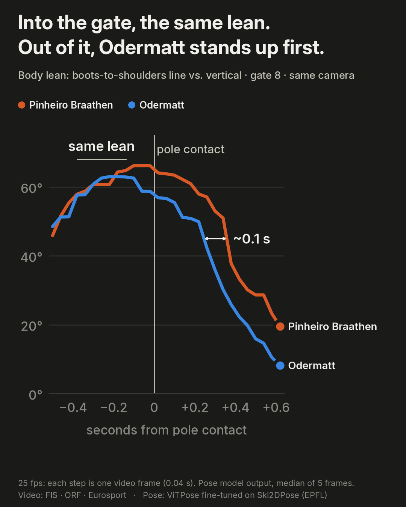

# ski-duel

Where does a World Cup giant slalom get won? Computer vision analysis of Lucas Pinheiro Braathen and Marco Odermatt in the first run of the Sölden giant slalom (25 October 2026), where Odermatt lost 0.55 s: race time synchronised to the frame from the TV broadcast, a pose model that also sees the skis, and body posture at the same gate.

## Result: gate 8



- **Same race time**: Pinheiro Braathen hits the gate-8 pole at 12.97 s; Odermatt gets there 0.14 s later (±0.04 s), consistent with the official split 1 (+0.10 s).
- **Same place**: gate 8 is the only turn where both were filmed by the same camera, so each run is aligned on its own pole contact and compared frame by frame. Into the gate both lean about 61° (boots-to-shoulders line vs. vertical). Out of it, Odermatt stands up about 0.1 s earlier (3 frames at 25 fps), while Pinheiro Braathen keeps 58-64° until +0.22 s.
- **Not a camera effect**: same camera and same spot, the skis point the same way in the image, and the two curves match on the way into the gate, where a camera bias would show too.
- **Caveat**: one gate of 25 fps broadcast video. It shows a difference in technique; it does not explain the 0.55 s.

## Pipeline

1. **Skier detection**: RT-DETR v2 (`PekingU/rtdetr_v2_r18vd`, COCO `person` + `skis`), preferring the person who is standing on skis.
2. **Pose with skis and poles**: ViTPose-base fine-tuned on Ski2DPose (24 keypoints). Off-the-shelf pose models do not see the skis.
3. **Frame-accurate synchronisation**: the broadcast clock is read in every frame (templates learned from the video itself, no external OCR), giving the race time of each frame to ±0.01 s. The frozen split times read from the graphic match the official FIS times to the hundredth.
4. **Posture at the same gate**: body inclination, hip height and ski angles of both skiers, filmed by the same camera and aligned on the moment each one hits the same gate pole.

## Pose model

Validation: 523 images from 2 held-out videos (PCK relative to the size of the skier, skis included; crops from the annotated box plus 5 %, as if from a perfect detector).

| Model | Keypoints | PCK@0.05 | PCK@0.10 |
|---|---|---|---|
| ViTPose-base (COCO, no fine-tuning) | 12 body joints | 72.9 % | 92.1 % |
| ViTPose-base (COCO, no fine-tuning) | skis and poles | not detected | not detected |
| **ViTPose-base fine-tuned on Ski2DPose** (25 epochs, CPU) | 12 body joints | **90.4 %** | **97.1 %** |
| | 8 ski points (tip, toes, heel, tail) | **81.9 %** | **93.7 %** |
| | 2 pole baskets | 62.3 % | 72.1 % |
| | all 24 | **85.9 %** | **94.1 %** |

The new 24-keypoint head is not initialised at random: each keypoint starts from the filter of its closest COCO joint (skis from the ankle, poles from the wrist). From random, body accuracy collapsed from 73 % to 13 % in the first iterations.

## Reproduce

Python 3.12 with PyTorch, Hugging Face Transformers, OpenCV, Matplotlib and imageio-ffmpeg. Everything runs on a laptop CPU (training: 30 epochs in about 6 hours). Code comments and names are in Spanish.

```bash
pip install -r requirements.txt --extra-index-url https://download.pytorch.org/whl/cpu
python src/to_coco.py data/ski2dpose                                    # Ski2DPose -> COCO keypoints, split by video
python src/baseline_vitpose.py data/ski2dpose out/baseline              # off-the-shelf ViTPose, for reference
python src/entrenar.py data/ski2dpose runs/vitpose24 --epocas 30 --lote 16   # fine-tune ViTPose to 24 keypoints
python src/sincronizar.py carreras/solden2026_gs_hombres.json           # race time of every frame from the TV clock
python src/pose_video.py carreras/solden2026_gs_hombres.json "PINHEIRO BRAATHEN Lucas/manga1" -0.5 54 \
    runs/vitpose24/mejor out/pose/braathen_m1_completa                  # detection + pose over a whole run
python src/pose_suave.py out/pose/braathen_m1_completa 1247 1300 runs/vitpose24/mejor out/pose/braathen_puerta8
python src/pose_suave.py out/pose/odermatt_m1_completa 3845 3902 runs/vitpose24/mejor out/pose/odermatt_puerta8
python src/postura.py out/pose/braathen_puerta8 out/pose/odermatt_puerta8 out/postura_puerta8 \
    --alinear 12.97 13.13 --nombres "Pinheiro Braathen" "Odermatt"     # lean, hip height... aligned on the pole contact
python src/video_final.py out/video/ski_duel.mp4                        # the 4:5 video and its thumbnail
```

The race data (official times, video offsets, the broadcast gate bar) is in `carreras/solden2026_gs_hombres.json`. The broadcast video is not included. The video uses the Inter typeface (SIL Open Font License), expected in `data/fuentes/`.

## Data

Ski2DPose (EPFL CVLab): https://www.epfl.ch/labs/cvlab/data/ski-2dpose-dataset

> R. Bachmann, J. Spörri, P. Fua, H. Rhodin. *Motion Capture from Pan-Tilt Cameras with Unknown Orientation*. International Conference on 3D Vision (3DV), 2019.

The dataset is not redistributed in this repository.

Official times: FIS / Longines (race 131578). Broadcast: FIS · ORF · Eurosport; no footage is included here.

## License

Code under the [MIT License](LICENSE). The dataset, the timing data and the broadcast belong to their owners.
